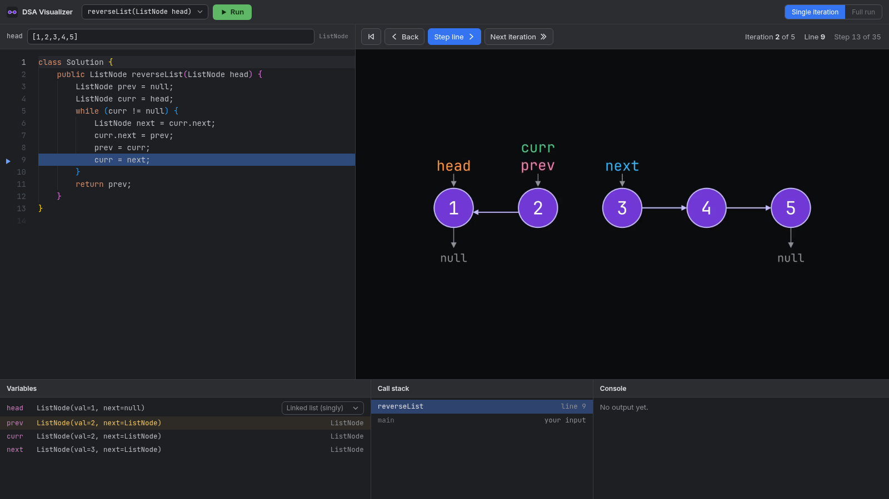
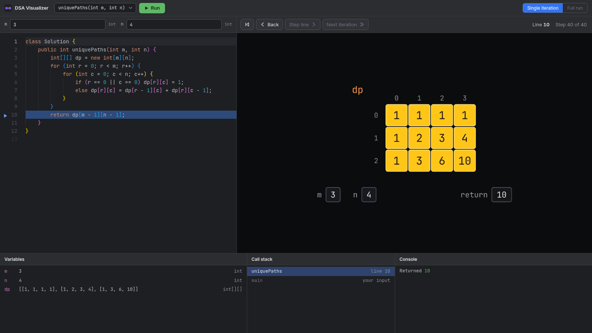
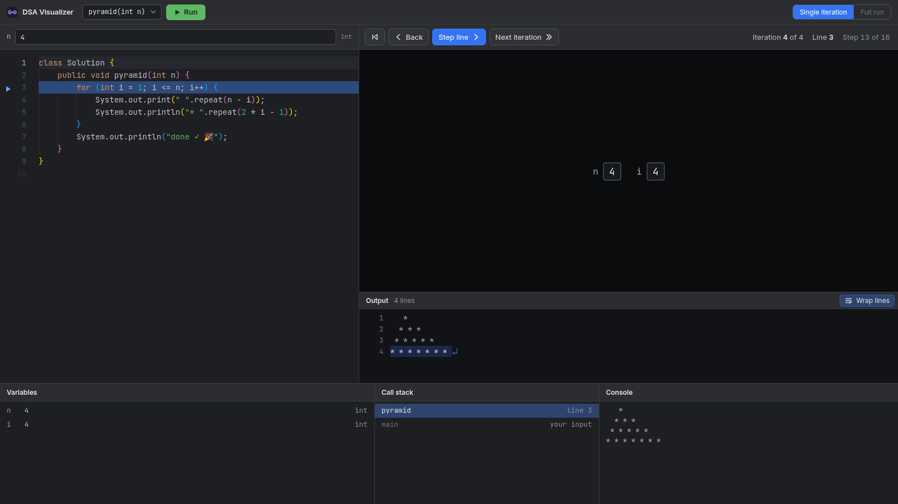

# Java DSA Visualizer

A step-through debugger for LeetCode-style Java solutions that animates your data structures as each line runs.

Paste a `class Solution`, type the input the way LeetCode shows it, press **Run**, and step through your code line by line.
Next to the code, a [Manim](https://www.manim.community/) animation shows every array, list, tree and map in its own shape, with pointers sliding and arrows rewiring as the code changes them.



## Why

Text debuggers show a list of variable values.
That is hard to picture when a loop is rewiring `next` pointers or filling a DP table.
This tool is built for learning: it shows what one iteration actually does, one line at a time.

## Features

- **Line-by-line stepping**, like a debugger: step forward, step back, jump to the next loop iteration, or go back to the start.
- **Animated data structures** that keep their positions between steps, so only what the code changed moves.
- **Automatic detection** of what each variable is, with a dropdown to redraw a linked list as singly, doubly, or circular.
- **LeetCode input format**: `[1,2,3]`, `[3,9,20,null,null,15,7]`, `"abc"`, `{"a": 1}`, and `pos=1` for a cycle.
- **Print output, step by step**: what `System.out` prints appears under the animation as you step, with the text the last line printed highlighted.
- **Errors where they happen**: compile errors are underlined in the editor, and runtime errors mark the line and the object involved, like the `null` that was dereferenced or the index past the end of an array.
- **Call stack** and **variables** panels that follow the current step, with changed values highlighted.

| Dynamic programming | Print output |
| --- | --- |
|  |  |

## What it can draw

| Kind | Example in code | Drawn as |
| --- | --- | --- |
| Primitives | `int`, `long`, `double`, `boolean`, `char` | Labeled value boxes |
| Strings | `String`, `StringBuilder` | A row of character boxes |
| Arrays | `int[]`, `char[]`, `String[]` | A row of cells, with index variables like `i` and `j` drawn as pointers |
| 2D arrays | `int[][]`, `boolean[][]` | A grid with row and column indices |
| Linked lists | `ListNode` with `next` (and `prev`) | Circles and arrows: singly, doubly, or circular |
| Binary trees | `TreeNode` with `left` and `right` | Circles in a tree layout |
| Collections | `ArrayList`, `LinkedList`, `Stack`, `ArrayDeque`, `PriorityQueue` | A strip of cells |
| Maps and sets | `HashMap`, `TreeMap`, `HashSet`, and their linked variants | A key-value table, or a set of values |

Your own node classes work too: any class with a field of its own type is treated as a list node, or as a tree node when the fields are named like `left` and `right`.

## Getting started

### Requirements

- [mise](https://mise.jdx.dev/), which installs the pinned Java 21 from `.mise.toml`
- [Maven](https://maven.apache.org/)
- [uv](https://docs.astral.sh/uv/) for the Python engine
- [Node.js](https://nodejs.org/) 22 or newer
- [ffmpeg](https://ffmpeg.org/), plus Cairo and Pango, which Manim needs ([Manim's install notes](https://docs.manim.community/en/stable/installation.html))

### Run

```bash
git clone https://github.com/pranav6266/java-dsa-visualizer.git
cd java-dsa-visualizer
./dsaviz --open
```

The first start builds the Java tracer and the web app, then serves the app at <http://localhost:8765>.
Later starts rebuild only what changed.
Pass `--port` to use a different port.

On Linux, `app/dsaviz-app` opens the visualizer in its own app window and stops the server a few minutes after you close it.
It uses Omarchy's `omarchy-launch-or-focus-webapp`, so on other desktops change its last line to open the URL in your browser.

## Using it

1. Paste a solution into the editor.
   It needs a class (usually `class Solution`) with the method you want to run.
2. Pick the method in the top bar, and fill in one input box per parameter.
3. Press **Run** or `Ctrl+Enter`.
4. Step through the code.

| Key | Action |
| --- | --- |
| `F7` or `→` | Step one line |
| `F8` or `Shift+→` | Jump to the next loop iteration |
| `←` | Back one line |
| `Home` | Back to the start |
| `Ctrl+Enter` | Run (in the editor) |

`ListNode` and `TreeNode` are provided the way LeetCode provides them, and LeetCode's usual imports (`java.util.*` and friends) are added for you.
Runs stop after 10,000 steps or 10 seconds, so an infinite loop shows up as an error instead of hanging, and the first 1,500 steps are animated.

## How it works

```text
 your code + input
        │
        ▼
 tracer/   Java 21: compiles your code, runs it in a second JVM under JDI,
           and records the stack, the reachable heap, and how much output
           was printed, before every line
        │  JSON trace
        ▼
 engine/   Python: finds loops and iterations, classifies each structure,
           lays them out so nodes stay put, and renders one Manim clip per
           step in the background
        │  steps + video clips
        ▼
 web/      React + Monaco: the editor, the step controls, the panels,
           and a player that plays the clip for each step
```

The design is in [docs/superpowers/specs](docs/superpowers/specs/2026-10-22-java-dsa-visualizer-design.md).

## Development

```bash
cd engine && uv run pytest          # end-to-end tests: real Java traces of the cases in examples/
cd web && npm test                  # web unit and component tests
cd web && npm run lint              # oxlint
```

`cd engine && uv run python scripts/preview.py OUT_DIR` renders still frames of the example cases, for checking the drawings by eye.

| Folder | What lives there |
| --- | --- |
| `tracer/` | The Java tracer: input parsing, compiling, and recording through JDI |
| `engine/` | The Python server, step analysis, layout, and the Manim renderer |
| `web/` | The React and TypeScript frontend |
| `examples/` | LeetCode cases used by the tests |
| `docs/` | The design spec, implementation plans, and README images |

## Status and roadmap

This is a personal learning tool that runs locally, one user at a time.
Only Java is supported.

Planned:

- Graphs, drawn the same way whether the code stores them as an adjacency matrix, an adjacency list, or `Node` objects
- A recursion mode that grows a recursion tree one call at a time, next to the memo table
- A full-run mode that plays the whole run as one animation

## License

[MIT](LICENSE)
